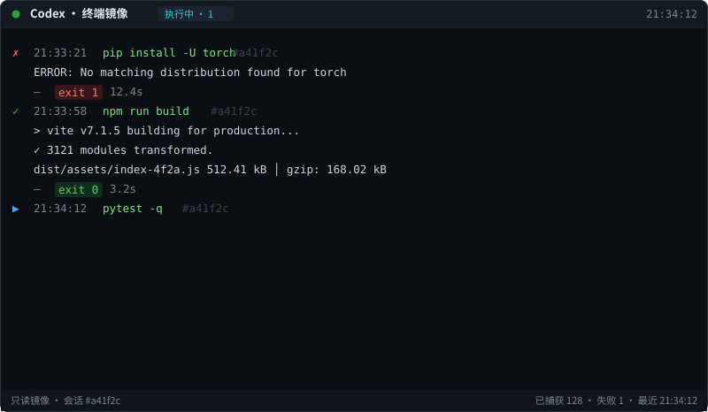

# Codex Shell Mirror

**在副屏上实时监督 Codex 对你的电脑做了什么。**

把 Codex 每次 shell 执行的命令、输出、退出码与耗时，实时投到一个无边框桌面小窗里——摆在副屏上一直开着，一眼就能看清 Codex 正在你机器上跑什么、成功还是翻车。

> 只读：它只监听 Codex 自己的会话日志，不执行任何命令、不改任何状态、不联网。



## 特性

- 实时镜像：命令 + 输出（400ms 轮询，只跟进新内容，不回放历史）
- 状态一眼可见：呼吸状态点 + 徽章（监听中·空闲 / 执行中·N / 已暂停）；每条命令 ▶→✓/✗，带动 exit 码与耗时
- 小窗任意缩放：拖边缘 / 四角改大小，拖顶部换位置；位置、大小、字号全部自动记忆
- 字号：Ctrl + 滚轮，或 Ctrl + / Ctrl -，Ctrl 0 复位；右键菜单里也有
- 单实例锁：重复启动自动让位
- 零依赖：纯 Python 标准库（tkinter），不用装任何第三方包

## 运行要求

- Python 3.9+，且带 tkinter
  - Windows / macOS：python.org 官方安装器默认带
  - Linux：`sudo apt install python3-tk`（Debian / Ubuntu 系）
- 本机装有 Codex（CLI / IDE 插件 / 桌面版均可，日志落在 `~/.codex/sessions`）
- 支持 Windows（主力测试）、macOS、Linux（基本可用，未充分测试）

## 快速开始

```bash
python codex_shell_mirror.py
# 常用参数示例：
python codex_shell_mirror.py --sessions-dir "D:\my\codex\sessions" --title "Codex · 监视器"
```

第一次运行后：拖顶部挪位置、拖边缘改大小，都会自动记住。

| 参数 | 默认 | 说明 |
|---|---|---|
| `--sessions-dir` | `~/.codex/sessions` | Codex 会话日志目录（也认 `CODEX_HOME` 环境变量） |
| `--lock-port` | `47811` | 单实例锁端口 |
| `--title` | `Codex · 终端镜像` | 窗口标题 |
| `--width` / `--height` | 800 / 466 | 首次启动尺寸（之后自动记忆） |
| `--font-size` | 9 | 首次启动字号（之后自动记忆） |
| `--version` | | 显示版本号 |

## 开机自启（可选）

- **Windows**：双击 `autostart/windows.bat` 可手动启动；给这个 bat 创建快捷方式放进启动文件夹（Win+R 输入 `shell:startup`）即可开机自启。
- **macOS**：把 `autostart/macos_launchagent.plist` 里的路径改成实际路径，放到 `~/Library/LaunchAgents/`。
- **Linux**：把 `autostart/linux.desktop` 里的路径改成实际路径，放到 `~/.config/autostart/`。

## 工作原理

Codex 会把每次会话的完整轨迹写进 `~/.codex/sessions/<年>/<月>/<日>/rollout-*.jsonl`。本工具只读这些文件的增量部分，提取其中的 shell 调用与输出并渲染。不执行命令、不联网、不改动任何东西（除了自身目录下的日志与窗口状态文件）。

## 常见问题

- **窗口一直空白？** 确认 Codex 正在运行（有新命令才会出现）；确认日志目录正确（`--sessions-dir`）。
- **想固定在副屏？** 把它拖到副屏即可；窗口默认置顶、95% 半透明。
- **不想要开机自启？** 删掉你放到启动项里的快捷方式 / 文件即可。

## License

MIT © caishi490-pixel · 制作：彩石 × 阿米（Codex）

---

### English

A tiny always-on-top, frameless desktop window that mirrors every shell command Codex runs on your machine — command, output, exit code and duration, in real time. Perfect on a secondary screen.

Read-only (it watches Codex session logs only), no network, zero dependencies (pure Python stdlib + tkinter). Requires Python 3.9+ with tkinter, and Codex running on the same machine. Run:

```bash
python codex_shell_mirror.py
```
